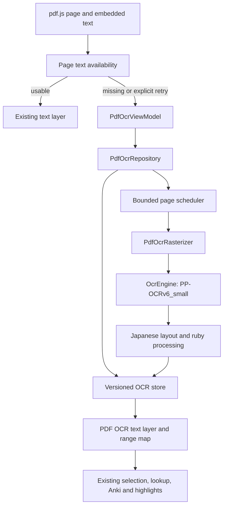

# OCR Architecture for Scanned PDFs

Date: 2026-09-29

Status: Original architecture proposal. The production backend is now
bundled PP-OCRv6_small (detection + recognition on ONNX Runtime, dependency-free
image math, build-time pinned official weights); see `docs/ARCHITECTURE.md`
for current implementation facts. The benchmark targets and unimplemented
capabilities below remain proposals, not validated results.

## 1. Recommendation

Add on-device, page-level OCR behind the existing PDF reader. Keep pdf.js responsible
for visible pages, zoom and text interaction; Kotlin owns OCR execution, Japanese
layout reconstruction and persistent results. Run OCR automatically when a page has
no usable embedded text, without delaying display of the scanned page.

The production backend is **bundled PP-OCRv6_small detection + recognition
on ONNX Runtime**, replacing the former ML Kit baseline for its Japanese
vertical-prose and ruby accuracy headroom. ML Kit Text Recognition v2 Japanese
remains the documented benchmark baseline for the quality/latency gate in
section 11, not a shipped backend.

The backend interface stays small so future engine changes do not affect the
reader, persistence or lookup implementation. Do not run two complete
engines on every page.

Adapt substantial parts of Chimahon's Japanese paragraph reconstruction, reading
order, ruby detection and overlapping-tile handling. Preserve the original OCR
observations, character geometry and source offsets; the existing Chimahon result
format loses information Hoshi needs. Enable each heuristic only after an ablation
shows an improvement. Post-processing can fix reading order and ruby contamination;
it cannot reliably recover a kanji that the recognizer never read correctly.

Default scope is offline recognition of printed Japanese, both horizontal and
vertical. Handwriting, historical scripts and manga sound effects are evaluation
cases, not promised capabilities. Cloud recognition, searchable-PDF export, book
search, OCR-based Sasayaki alignment and EPUB/VN changes are outside this slice.

## 2. Existing code and behavior to preserve

The review used Hoshi commit `e601cfe` on `feat/pdf-support`, and the supplied
`C:/Users/nam/AndroidStudioProjects/chimahon-main` directory. The latter has no Git
metadata, so it cannot be assigned a verified upstream revision. The inspected
`OwOCRMerger.kt` SHA-256 is
`629c2351899dfd17ca408793e33bab138ea03a69b6d1f5aad78b3b4892f503f2`.

Paths below are relative to the Hoshi root unless labeled Chimahon.

| Existing owner | Relevant behavior / integration point |
| --- | --- |
| `app/src/main/java/moe/antimony/hoshi/epub/BookRepository.kt` | Imports/copies PDFs into private book storage, resolves the packed PDF safely, stores common sidecars, and coordinates deletion through `BookWorkRegistry`. OCR must use that book identity and deletion boundary. |
| `app/src/main/java/moe/antimony/hoshi/epub/PdfBookParser.kt` | Uses `PdfRenderer` for page count and first-page cover rendering. There is no OCR. Its cover resolution is unsuitable as the OCR input. |
| `app/src/main/java/moe/antimony/hoshi/epub/PdfBook.kt` | Represents progress using page count/index, including the `bookinfo.json` compatibility shim. OCR must not turn this into character-based progress. |
| `app/src/main/java/moe/antimony/hoshi/navigation/ReaderRouteStateHolder.kt` | Loads `ReadyPdf`, the packed file, bookmark and book metadata off the main thread. Keep OCR out of this blocking open path. |
| `app/src/main/java/moe/antimony/hoshi/features/reader/PdfReaderWebView.kt` | Owns the current PDF Compose host, typed `PdfReaderMessage`, WebView bridge, lookup/Anki popup stack and highlight persistence. Add an entry-scoped OCR ViewModel rather than more long-running Compose state. |
| `app/src/main/assets/hoshi-web/pdf-reader/pdf-reader.js` | Lazily renders visible/nearby pages. `renderTextLayer()` uses `page.streamTextContent()`, records DOM text nodes and `pageText`, and discards offscreen DOM/canvases. OCR fills the missing text-provider role. |
| `app/src/main/assets/hoshi-web/shared/selection*.js` | Existing language-aware selection and sentence extraction used by the PDF page. Preserve the dictionary/Anki selection contract. |
| `docs/ARCHITECTURE.md` | PDF is an Android-only reader with shared highlights, lookup and statistics; PDF has no book search or Sasayaki matching. |

PDF highlights currently use `character = zero-based page index`, `offset =
page-local UTF-16 offset`, and exact selected `text`. `applyHighlightsToPage()`
checks that the text still matches at that offset. A new OCR layer must satisfy
that same contract. Re-rendering after zoom must retain old pixels until the new
canvas can replace them, as the current PDF implementation does.

### iOS reference findings

The checked-in `reference/Hoshi-Reader-iOS/Features/Bookshelf/BookshelfView.swift`
imports `.epub`; searching the Swift sources found no PDF/OCR implementation.
Consequently there is no iOS OCR state flow to reproduce. This proposal extends
the existing Android-only PDF feature.

The shared interaction remains aligned with iOS:
`Features/Reader/ScrollReaderWebView/ScrollReaderWebView.swift` receives selected
text, sentence, anchor rectangle, normalized offset and cloze offset, passes them
to lookup, and highlights the matched selection. OCR must supply genuine source
text and stable offsets to that flow. The scanned image remains the visual source;
recognition does not replace it with reflowed text or automatically open a popup.

## 3. OCR engine decision

| Candidate | Fit for this task | Decision |
| --- | --- | --- |
| Bundled ML Kit Japanese v2 | Official Android integration; blocks/lines/elements/symbols and geometry; model available without an initial download. Japanese performance must be measured separately from Latin. | Former backend, now removed; retained as the benchmark baseline for the section 11 quality/latency gate. |
| PP-OCRv6_small | Current Paddle family intended for mobile/desktop; small and medium support Japanese. Official Android deployment uses ONNX Runtime and exposes polygons/confidence. | Required challenger; preferred replacement if it wins the Japanese quality/latency gate. |
| PP-OCRv6_tiny | The official model description explicitly excludes Japanese from tiny. | Do not use the tiny recognizer for this Japanese feature. |
| PP-OCRv5_mobile | Earlier mobile baseline with Japanese support; useful if the v6 export/runtime regresses on a supported device. | Secondary benchmark, not the assumed newest model. |
| Manga OCR | Japanese manga specialist supporting vertical/horizontal text and furigana; its image-to-text output alone does not provide Hoshi's page detection and character-location contract. | Possible later crop recognizer, requiring detection/alignment and Android profiling; not the whole-page default. |
| Tesseract `jpn` / `jpn_vert` | Reproducible offline baseline with separate fast/best model families. | Optional comparison; no evidence from this review to prefer it for Hoshi's mixed-layout PDFs. |
| Chimahon private Lens / network Lens | The supplied code uses native Lens internals/downloaded binaries and a separate network client. It is not the ML Kit public API. | Do not adopt as Hoshi's backend. Reuse post-processing independently. |

Primary references: [ML Kit](https://developers.google.com/ml-kit/vision/text-recognition/v2/android),
[PP-OCRv6 model scope](https://www.paddleocr.ai/latest/en/version3.x/algorithm/PP-OCRv6/PP-OCRv6.html),
[Paddle Android deployment](https://www.paddleocr.ai/latest/en/version3.x/inference_deployment/cross_platform/android_deployment.html),
[PP-OCRv5](https://www.paddleocr.ai/main/en/version3.x/algorithm/PP-OCRv5/PP-OCRv5.html),
[Manga OCR](https://github.com/kha-white/manga-ocr), and
[Tesseract model families](https://tesseract-ocr.github.io/tessdoc/Data-Files.html).
Published desktop/GPU timings and aggregate model accuracy are not Android Japanese
PDF measurements and must not be copied into Hoshi performance claims.

For PP-OCRv6_small, line-level text comes from the CTC head, so retain the
detection quad per line instead of expecting symbol output. Confidence is
engine-specific and must not be compared directly across backends.

For Paddle, start from the official Android SDK/source and pinned official model
artifacts. Its demo documents an API-26 minimum, ONNX Runtime and OpenCV; that does
not establish compatibility with Hoshi's complete native dependency graph. Audit
ABI coverage, release shrinking, native-library collisions with transcription,
16 KB page-size support and total installed size, following
[Android's native page-size guidance](https://developer.android.com/guide/practices/page-sizes).
Pin `onnxruntime-android` to 1.27.0 or newer: full 16 KB-page compatibility for
the Android package landed in 1.27.0, which Google Play requires for apps
targeting Android 15+. Keep the R8 `-keep class ai.onnxruntime.**` rule from
the official Android build guidance.
Use CPU first; benchmark any
accelerator against it. [ONNX Runtime's mobile guide](https://onnxruntime.ai/docs/tutorials/mobile/)
describes Android execution options. Model weights, recognition dictionary,
preprocessing and decoder must be versioned together. Avoid JPEG round trips;
use bitmaps or lossless input after verifying equivalent preprocessing.

If optional Paddle models are downloaded, use immutable URLs, sizes and SHA-256
checks with atomic publication. Bundle the approved runtime in the app for the
initial Paddle integration; do not copy Chimahon's downloaded `.so` mechanism or
assume Hoshi's speech runtime exposes a general OCR session API. Show model size
and download progress before the optional download, then support offline reuse.

## 4. Ownership and data flow

All new names below are proposed. Keep them in the current app module initially.



| Proposed component | Responsibility |
| --- | --- |
| `features/reader/PdfOcrViewModel.kt` | `@HiltViewModel`, scoped to the Reader Nav3 entry; immutable page states as `StateFlow`; viewport/retry/mode events. No Activity-wide scope. |
| `ocr/pdf/PdfOcrRepository.kt` | Resolve book source, fingerprint it, deduplicate requests, orchestrate raster/engine/postprocessor/store and coordinate book deletion. Expose main-safe suspend/Flow APIs. |
| `ocr/pdf/PdfOcrRasterizer.kt` | Own read-only file descriptors, `PdfRenderer`, render matrices, tiles and bitmap lifetime. Serialized renderer access on an injected worker dispatcher. |
| `ocr/OcrEngine.kt`, `ocr/paddle/PaddleOcrEngine.kt` | Backend interface and PP-OCRv6_small adapter (ONNX Runtime sessions, dependency-free detection/recognition math, bundled pinned weights). Reuse the session holder; never create one per Composable or line. |
| `ocr/paddle/PaddleOcrEngine.kt` | Benchmark/optional adapter with its own validated model/runtime lifecycle. |
| `ocr/layout/JapaneseOcrPostprocessor.kt` | Pure deterministic layout, ruby association and ordered text construction. No UI, dictionary repository or `Context`. |
| `ocr/pdf/PdfOcrStore.kt` | Atomic per-page records, revisions, pinned highlight snapshots, quota and invalidation. Kotlin Serialization. |
| `di/OcrModule.kt` | Hilt bindings, engine configuration and dispatcher qualifiers. |
| `assets/hoshi-web/pdf-reader/pdf-ocr-layer.js` | Geometry projection, selectable DOM, OCR range lookup and revision-aware installation; no recognition algorithm. |

`OcrEngine.recognize(input)` returns a structured result, distinguishing success
with zero observations from failure/unavailable. The input includes the owned
bitmap, language, image dimensions and preprocessing transform. The output includes
verbatim text, quads, nullable confidence, orientation evidence and optional
element/symbol geometry. Coroutine cancellation does not imply native inference
has stopped; the adapter retains the bitmap and engine permit until completion.

## 5. When OCR runs and how it feels

Assess each page independently. A scanned book may have a selectable cover or TOC,
and a digital book may contain scanned inserts.

1. Display the canvas immediately. Extract embedded text once per source page,
   independently of later zoom rendering.
2. Classify text as `Usable`, `Missing`, `Suspect`, or `ExtractionFailed`. Ignore
   whitespace/control-only items and invalid/zero-area geometry when deciding
   usability. Do not use an arbitrary minimum character count that rejects a
   legitimate one-character page.
3. `Missing` queues OCR automatically. `Usable` uses the current layer unchanged.
   `Suspect` covers replacement/private-use-heavy text or an isolated page number
   over a scanned body; offer a page OCR action rather than automatically replacing
   valid embedded text. An extraction exception is a retryable error, not proof
   that the PDF is scanned. Manual OCR remains available.
4. Install a complete OCR result atomically when the page/session request is still
   current. Leave the canvas, scroll position and zoom intact. A page with no
   recognized text remains readable as an image.
5. A retry or alternate quality pass creates a candidate revision. Never change
   active selection/highlight offsets midway through a gesture or popup session.

For mixed pages, version one selects one text provider for the whole page:
embedded text by default, OCR after an explicit page override. Do not stack both
layers and create duplicate lookup targets. Region-level blending is future work
requiring spatial duplicate suppression and an explicit combined offset model.

Page state is:

```text
Unassessed -> EmbeddedReady
          -> Suspect / ExtractionFailed
          -> Queued -> Rasterizing -> Recognizing -> Postprocessing -> OcrReady
                                                               -> NoText
                    -> Failed(reason, retryable)
```

Cancellation returns an unfinished request to an idle/retryable state; it is not
cached as `NoText`. Keep `NoText` distinct from model-not-installed, unsupported
page geometry, corrupt PDF, storage failure and inference failure. Cache successful
empty results so illustrated/blank pages do not loop indefinitely; explicit retry
or a pipeline-version change can reassess them.

Use a small page-local progress/status indication and existing localized errors or
Snackbar with Retry. The PDF page is usable throughout. User-visible wording belongs
in both `values/strings.xml` and `values-zh-rCN/strings.xml`, with `UiText` outside UI.
No camera, media-projection or broad storage permission is needed for imported PDFs.

## 6. Rasterization, geometry and bounded execution

### Native raster input

Render directly from the imported PDF using a new `PdfRenderer` owner, not the
cover bitmap or a screenshot of the WebView. Use a white `ARGB_8888` destination
and an explicit transform. Raster work and file access stay off the main thread.
Serialize page open/render/close and close resources in all completion paths;
the official [PdfRenderer reference](https://developer.android.com/reference/android/graphics/pdf/PdfRenderer)
describes its lifecycle/concurrency behavior.

Initial tuning hypothesis: approximately 200 DPI, capped at 3 megapixels per input
bitmap, with a bounded higher-resolution crop/tile retry for small type. These are
benchmark starting points, not measured optimal settings. Google's input guidance
suggests roughly 16–24 pixels per character; dense kanji/ruby may require different
tuning on the actual corpus. A 3-megapixel ARGB bitmap alone occupies about 12 MB,
before model tensors, copies and the existing PDF canvases.

Generate high-resolution tiles directly from the PDF instead of allocating a huge
full-page bitmap then cutting it up. Overlap tiles to avoid clipped glyphs and keep
every crop/scale/rotation transform. Process/release them sequentially. Choose tile
boundaries from likely whitespace where possible; vertical Japanese columns must
not be split without overlap. Do not automatically threshold, sharpen or deskew
every page: destructive filtering can erase dakuten and thin strokes. Evaluate
these as bounded retries, retaining the unmodified candidate.

### One coordinate contract

Persist quads in a canonical **display-oriented page plane**, top-left origin,
normalized to `[0,1]`, with the effective crop rectangle, intrinsic page rotation
and plane dimensions recorded. Preserve full quads; an axis-aligned rectangle is
only a broad-phase hit-test bound.

Define matrices rather than adding independent scale corrections:

```text
engine pixels -- inverse preprocessing/tile transform --> native page plane
native page plane -- validated crop/rotation mapping --> canonical page plane
canonical normalized point (u,v) --> (u * CSS page width, v * CSS page height)
```

The native `PdfRenderer` plane and pdf.js viewport must describe the same effective
page. A width/height ratio alone does not prove this: CropBox/MediaBox differences,
nonzero origins, `/Rotate`, `/UserUnit` and rounding can move text. Prototype and
validate this mapping on API 26 and modern Android before enabling OCR overlays.
Carry pdf.js page-view metadata in the typed request; do not rotate twice when a
renderer has already applied `/Rotate`. If a page's mapping is unsupported, retain
its image and report OCR unavailable rather than drawing an inaccurate overlay.
General support for those pages requires a separately validated raster adapter,
not an ad hoc stretch correction. This is an implementation gate.

Inside pdf.js use CSS viewport dimensions, not device-pixel canvas dimensions.
The current canvas has its own pixel/dimension cap, so devicePixelRatio is not a
reliable inverse transform. During pinch preview, canvas and text stay in the same
transformed parent; final zoom only reprojects the cached result. Popup geometry
continues through the existing `hoshiPopupGeometry` path; no new CSS-zoom correction.

Do not depend on Android's newer native text extraction to detect missing text:
[`PdfRenderer.Page.getTextContents()` is API 35+](https://developer.android.com/reference/android/graphics/pdf/PdfRenderer.Page#getTextContents()),
while Hoshi's minimum is API 26 and pdf.js already provides extraction.

### Scheduling

Use a process-wide engine concurrency limit of one initially, a per-document raster
owner, and one pending request per `(source, page, pipeline configuration)`. Visible
pages outrank one-page prefetch; drop obsolete prefetch when direction changes.
Do not OCR the entire existing five-page render window concurrently. Zoom never
invalidates OCR. Limit in-flight pixels, output observations, native threads and
retained DOM; a semaphore alone does not bound an unbounded queue.

Interactive requests belong to the Reader entry lifecycle. Cancel queued work when
leaving it, let uncancellable inference finish safely without UI publication, and
replay persisted results on reopen. Configuration recreation must not create a
second job. Integrate with `BookWorkRegistry`: deletion cancels jobs and prevents a
late write from recreating the book's OCR data.

`BookWorkRegistry` currently permits only one registration per book. Register a
single OCR document coordinator that owns all its page jobs, not one registration
per page. Foreground and later batch OCR must share that coordinator. If another
book-owned task needs concurrent registration, extend the registry's ownership
contract deliberately rather than bypassing deletion coordination.

Whole-book background OCR is optional later work. If offered, use unique,
checkpointed `@HiltWorker` WorkManager jobs with small page batches and the same
repository/scheduler. Persist page results outside WorkManager `Data`; only IDs and
progress counters travel through it. Foreground work preempts batch work at page
boundaries. Android 16 job quotas also affect long-running workers, so do not
promise uninterrupted whole-book execution or assume a foreground worker removes
quotas. See [Android's long-running worker guidance](https://developer.android.com/develop/background-work/background-tasks/persistent/how-to/long-running).

## 7. Chimahon processing to adapt

Chimahon-relative paths and observed behavior:

| Source | What is useful | Required Hoshi adaptation |
| --- | --- | --- |
| `chimahon/src/main/java/chimahon/ocr/EngineLine.kt` | Backend-neutral text, bounds, orientation and character-size estimate. | Preserve verbatim text, full quads, source IDs, confidence and symbols; measure distances in one isotropic page/pixel plane. Normalized x and y have different physical scales. |
| `.../OwOCRMerger.kt`: `globalFuriganaFilter` | Small kana near larger kanji, thickness/proximity/overlap and right-of-vertical/above-horizontal placement. | Associate ruby with a plausible parent rather than permanently deleting it. Require orientation and local-size evidence; retain ambiguous small kana, punctuation, captions and sound effects. |
| `.../OwOCRMerger.kt`: `createParagraphsFromLines`, `shouldGroupInSameParagraph` | Orientation-, rotation-, overlap- and character-size-aware grouping. | Add column/gutter and region boundaries for printed PDFs. Use bounded spatial candidate lookup; the Japanese grouping implementation scans line pairs and can become quadratic on dense pages. |
| `.../OwOCRMerger.kt`: `createParagraphFromLines`, `mergeCloseParagraphs` | Vertical right-to-left column order, horizontal top-to-bottom lines, retention of constituent boxes. | Keep ordered source-line IDs and their ranges. Disable aggressive cross-paragraph merging until separately validated for prose, headings and footnotes. |
| `.../OwOCRMerger.kt`: `groupParagraphsIntoRows`, `reorderParagraphsInRows`, `reorderMixedOrientationBlocks` | Mixed-orientation reading-order reconstruction. | Use deterministic tie-breakers and bounded reordering. Manga-oriented row heuristics must not interleave two prose columns or merge captions into body text. |
| `.../ImageChunking.kt` | Overlap, chunk-to-image remapping and spatial/text boundary deduplication. | Stream native PDF tiles; deduplicate observations before paragraph assembly. Transform quads and recompute character size, not just box y coordinates. Exact `text + bbox` equality misses imperfect duplicates. |
| `.../OcrHitTester.kt` | Rotation-aware point-to-line logic and normalized hit regions. | Prefer real symbols; fallback estimates use grapheme boundaries mapped to UTF-16. Existing equal-width `text.length` slicing is not accurate character geometry. |
| `.../OcrPreprocessor.kt` | Punctuation cleanup experiments. | Do not apply destructive cleanup to canonical text: it collapses sequences such as `!?` and ellipses, changing content and offsets. Optional lookup normalization needs a reversible boundary map. |
| `.../OcrLookupText.kt` | Examples of language-sensitive lookup behavior. | Reuse Hoshi's existing Japanese/English selection semantics; do not import a competing dictionary/Anki layer. |

The supplied `processChunks()` runs the merger after collecting observations, and
deduplicates merged boundary results afterwards. Hoshi should deduplicate first,
using overlap, orientation and compatible text with source provenance. Keep repeated
words at distinct locations. When tile candidates disagree, prefer an unclipped
observation or a calibrated better candidate; never concatenate competing guesses.

Chimahon's Japanese merger joins lines with newlines. Hoshi needs two explicit
representations: raw engine observations, and a canonical reading stream with line
and paragraph boundaries. Soft wraps within a confirmed Japanese paragraph can be
joined without a space; preserve genuine Latin word spaces and paragraph breaks.
Record every removed separator and ruby exclusion in the source map. Paragraph
grouping uncertainty must limit sentence expansion rather than join unrelated text.

Suggested deterministic pipeline:

```text
raw observations + provenance
  -> map geometry to one page plane; reject invalid coordinates
  -> resolve overlapping-tile duplicates
  -> identify text regions, directions and local character scale
  -> associate ruby candidates (retain raw observations)
  -> group lines within region/column boundaries
  -> order lines and paragraphs with deterministic tie-breakers
  -> construct canonical text, ruby associations and UTF-16 source map
  -> attach quality flags; atomically publish one page revision
```

Keep ambiguous ruby as body text by default. A well-supported ruby association can
exclude the reading from the base lookup stream while retaining its geometry and
reading text; a ruby tap maps to the base range. Do not synthesize a reading from a
dictionary and call it OCR output. Avoid automatic kanji replacement or LLM repair
of prose; retry image evidence instead. Dictionary presence alone is not evidence
of correct recognition, especially for names and uncommon vocabulary.

Chimahon's `LocalOcrBridge` instantiates `LensEngine`; its native shim initializes
private Lens assets and includes a GOT-patching fallback. The Paddle adapter loads
`manga_det_fp16`, `manga_rec_fp16`, `ppocrv6_dict.txt` and downloaded native libraries;
the supplied C++ directory does not provide that Paddle inference implementation.
Those filenames do not establish equivalence to official PP-OCRv6_small weights.
The adapter also parses native scores/order IDs without retaining them in
`EngineLine`. Do not import those limitations or claim its engine has been benchmarked
here. Its useful separation of native recognition from shared ruby filtering should
be retained: only one stage owns ruby exclusion.

Both local project roots contain GPLv3 license text; Chimahon credits owocr and the
preprocessor credits Mangatan. Before copying code, record source/version or file
hash, preserve applicable notices and inspect upstream/per-file terms. That source
reuse review is separate from permissions for downloaded model/runtime assets.

## 8. Text, offsets and WebView integration

A page result needs more than `List<String>` or a paragraph bounding rectangle:

```text
OcrPageRecord
  schemaVersion, sourceSha256, pageIndex
  engineId, engine/model/runtimeVersion, language, pipelineVersion, configHash
  pageGeometry, rasterPlan, revisionId, status
  rawObservations[]: id, rawText, quad, direction, confidence?, symbols?
  paragraphs[]: id, orderedLineIds, canonicalStartUtf16, canonicalEndUtf16
  canonicalText
  spans[]: sourceId, [startUtf16,endUtf16), quad, geometryPrecision
  rubyAssociations[]: readingSourceIds, baseRange, confidence
  sourceBoundaryMap, qualityFlags
```

All intervals are half-open. Kotlin strings and JS DOM offsets use UTF-16; quality
metrics count Unicode code points separately. Preserve surrogate pairs and combining
marks, including supplementary kanji and kana with combining dakuten. `geometryPrecision`
distinguishes observed symbol/element geometry from estimated line subdivision.
Engine confidence, ruby confidence and paragraph quality are separate values.

Add a `PdfPageTextSource` abstraction inside the PDF runtime with embedded and OCR
implementations. Both publish the page's canonical text, source revision, selectable
layer and range-to-geometry projection. The embedded implementation retains today's
text concatenation and offsets exactly.

For OCR, create transparent positioned text in canonical reading order, with
horizontal/vertical writing direction per line and actual symbol geometry where
available. The page stream and DOM text concatenation must agree, including explicit
paragraph separators; never rely on a `<br>` contributing an offset. Ruby annotation
nodes must not duplicate text in the base stream. Do not feed fabricated font metrics
into pdf.js `TextLayer` and assume they describe OCR glyphs.

Use the OCR range map for tap anchoring and highlight quads when browser font
metrics cannot align precisely with the scan. Estimated line cells remain marked
as estimates and require tap/drag tests. DOM order enables selection, but DOM
`Range.getClientRects()` alone is not proof of accurate scan alignment. Extend the
existing PDF highlight projection behind the text-source interface rather than
creating a second highlight persistence system. Reject cross-page selections as
the current PDF implementation does.

Selection sends the existing `ReaderSelectionData` contract: lookup suffix, complete
sentence within the confirmed paragraph, anchor rectangle and valid cloze offset.
Build semantic text from the immutable page result, never from the visible tile or
currently mounted subset. Maintain the current shared language normalization;
do not create a fourth version of reader text semantics or couple PDF to VN streams.

Extend `PdfReaderMessage` with bounded availability/request events carrying
`readerSessionId`, `pageIndex`, `requestId`, source fingerprint and page geometry.
Kotlin validates these against its active book; JS never supplies a filesystem path.
Responses include the same identity plus `revisionId`. The WebView accepts them
only if the session/page request is current; discarded pages can reload the result
from the store. Source replacement, renderer restart and book deletion invalidate
pending UI deliveries.

Return page JSON through a session-bound endpoint on the existing
`https://appassets.androidplatform.net` resource bridge, with only a small typed
notification sent via `evaluateJavascript`. Bound payload size/counts and serialize
JSON properly; OCR strings become DOM `textContent`, never HTML/script fragments.
Retain the existing restricted asset-loading/security defaults. Do not move bitmaps
as base64 through `JavascriptInterface` or send page images to a network service.

## 9. Persistence and highlight stability

Store Android-only derived OCR outside iOS-compatible book sidecars, for example:

```text
noBackupFilesDir/pdf-ocr/<source-sha256>/<pipeline-key>/<page-index>/<revision>.json
```

Use an internal index mapping book identity to source hash and active/pinned page
revisions. Compute the source hash once on import or first OCR, off the main thread;
reuse it only while the immutable imported source identity is unchanged. Reimport,
replacement or sync replacement requires a new hash. Do not trust filename alone.
Write atomically and validate schema, text ranges and finite/bounded coordinates
before loading. Partial writes are discarded safely.

Key derived results by source bytes, page, language, exact model/runtime identity,
postprocessor version and effective raster/configuration. Zoom, theme, popup scale
and dictionary choice do not invalidate OCR. Keep raw observations so a new layout
algorithm can be evaluated without rerunning recognition.

The store is quota-managed, but results referenced by local highlights are pinned.
When an OCR highlight is created, first persist its page revision and a local
`highlightId -> revisionId + sourceHash + pageIndex` anchor record, then write the
existing highlight sidecar. Crash recovery can remove an unused pin; it must not
leave a committed highlight without its source revision. A model/postprocessor
upgrade must not silently move that highlight onto a different text occurrence.

Keep old revisions while annotations depend on them. Switching to a new revision
requires unique exact-text/context and spatial correspondence; ambiguous matches
stay unresolved and preserve the original highlight. The existing exact-offset/text
check remains a final guard, not a complete revision-migration algorithm.

Because the OCR store is deliberately excluded from existing sync/backup formats,
another device or a restored installation can receive a highlight without its OCR
revision. Preserve the sidecar record; do not guess an anchor from a repeated quote.
Cross-device deterministic OCR highlight replay is not promised by version one.
Portable OCR caches/anchors need a separate compatible export/sync design. Normal
PDF bookmarks, statistics, embedded-text highlights and iOS sidecars stay unchanged.

Deleting a book removes its store references and pins under the work registry;
shared source records can be collected when no book references them. Unpinned
results may be evicted by quota. A corrupt record triggers page recomputation,
not deletion of the PDF or its annotations.

## 10. Implementation slices

1. **Evidence and geometry prototype:** assemble licensed/tracked fixtures, compare
   native raster alignment with pdf.js across crop/rotation cases, then benchmark
    production PP-OCRv6_small with raw output retained. Resolve
   backend and geometry gates before building extensive UI.
2. **Vertical slice:** route-scoped ViewModel, native raster owner, one engine,
   page availability probe, bounded scheduling, versioned store and one-page OCR
   selectable overlay. Exercise lookup, sentence/cloze, highlight and reopen.
3. **Japanese processing:** adapt Chimahon stages with source mappings and ruby
   associations, one ablation at a time. Add tiles, deterministic ordering and
   measured retries; preserve embedded PDF regressions throughout.
4. **Lifecycle and delivery:** renderer death, deletion races, low memory, model
   upgrade, release packaging and optional model download. Only then consider
   durable whole-book WorkManager processing or a user-facing alternate engine.

When implementation lands, update current architecture facts and the existing PDF
entry in `[Unreleased]` in `docs/CHANGELOG.md`. This proposal itself changes neither
current app behavior nor the current-architecture document.

## 11. Accuracy, speed and validation gates

No engine or heuristic in this proposal has been measured on the user's devices.
Use at least 100 independently labeled pages from multiple documents, with a held-out
set separated by book. Include vertical novels with dense ruby, horizontal prose,
mixed Japanese/Latin/numbers, multicolumn pages, small kana, headings, captions,
low-resolution/noisy scans, rotated/cropped pages, manga panels and blank/illustrated
pages. Include digital and mixed PDFs to measure false OCR activation. Fixtures must
be tracked with appropriate rights or generated by tests, not taken from ignored
local `testdata/` paths.

Ground truth contains body text, ruby separately, paragraph/line reading order,
region geometry and tap-to-character targets. Report:

- Raw and final body character error rate: `(substitutions + deletions + insertions)
  / reference code points`. Report kanji and kana subsets, punctuation-preserving
  and explicitly normalized scores; do not hide damage with aggressive normalization.
- Detection recall, line/paragraph ordering errors, ruby association precision and
  recall, and incorrectly deleted body characters. Recognition and layout errors
  need separate diagnoses.
- Tap-to-character/lookup success, correct sentence and cloze extraction, highlight
  replay and geometry alignment after zoom. Better-looking text alone is insufficient.
- Cold initialization and warm p50/p95 time from page request to usable layer,
  broken down into raster, inference, post-processing, persistence and DOM install.
  Include blank and dense pages, cache hits and thermal steady-state runs.
- Peak app/native/WebView memory, model/download/installed size, sustained CPU load,
  UI frame stalls and battery impact while turning pages and looking up words.

Compare production PP-OCRv6_small against the ML Kit baseline and each
post-processing stage with raw output retained. Test the same raster plans
and then each engine's tuned plan. Record model hashes, runtime, thread count, ABI, OS and device. Include a
current phone and a slower supported device/E-ink reader; emulator timing is not
the engine-selection evidence.

Initial product targets, subject to device measurements:

| Gate | Proposed target |
| --- | --- |
| Clean printed Japanese | Body CER at most 2% in both horizontal and vertical subsets; inspect kanji errors separately. |
| Warm visible-page OCR | p95 at most 2 seconds on the selected midrange reference device at the agreed raster plan. Slower devices remain responsive and expose progress. |
| Cached page | OCR layer installation p95 under 100 ms, measured separately from PDF rendering. |
| Peak incremental memory | Aim below 96 MiB for OCR, measured in the combined reader; reduce pixels/prefetch on low-memory devices. |
| Post-processing acceptance | Improve held-out CER, ruby contamination, order or lookup success; no material body-deletion regression in any major layout subset. |
| Backend replacement | Prefer PP-OCR when it meets the budgets and improves body CER by at least 10% relative, or resolves a critical vertical/ruby failure without a material regression elsewhere. |

These values are acceptance proposals, not benchmark results. If neither engine
meets them, investigate detection, crop resolution and vertical/ruby handling rather
than claiming that a more elaborate merger makes an inadequate recognizer accurate.

Tests should verify behavior and state flow:

- Pure Kotlin: mixed orientation, ruby false positives, punctuation preservation,
  tile overlap, supplementary kanji, combining marks, stable ordering, source maps,
  cache invalidation, revision pins and deletion/cancellation races.
- JS: missing/usable text decisions, canonical DOM offsets, stale response rejection,
  soft wraps/paragraphs, OCR highlight projection, zoom/discard/reload and preservation
  of existing embedded text behavior.
- Device/WebView: native/pdf.js geometry parity (0/90/180/270 degrees, CropBox origins,
  UserUnit and different sizes), tap/drag selection, dictionary/Anki sentence/cloze,
  pinch/buttons/fit-width, renderer death, process recreation, offline cold start,
  large PDFs, storage failure and low memory. Never require clearing user data.

For the eventual implementation, follow `docs/VALIDATION.md`: run `./gradlew test`
and `./gradlew assembleDebug`; reader asset changes also require
`node --test app/src/test/js/*.test.mjs`. Run lint for UI/resources/manifest/packaging,
and `./gradlew :app:assembleRelease` for native or release packaging changes. Build
and install device tests non-destructively under the existing validation policy;
do not run a connected task that clears/reinstalls app data. A documentation-only
change requires source/link and diff review; it does not establish any of these
runtime acceptance results.
